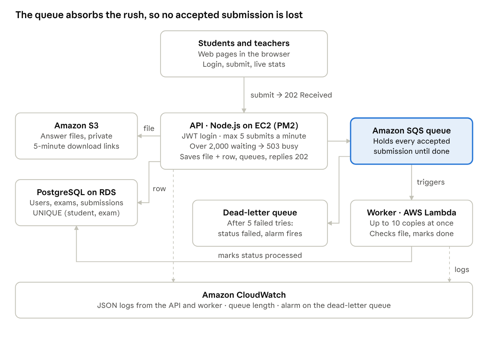
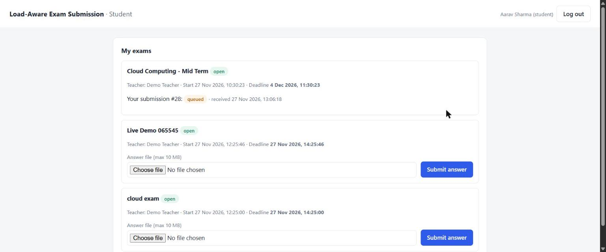
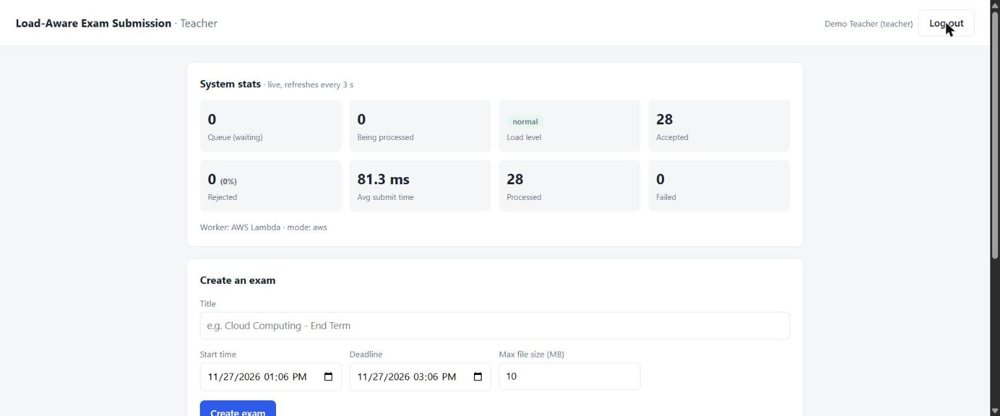
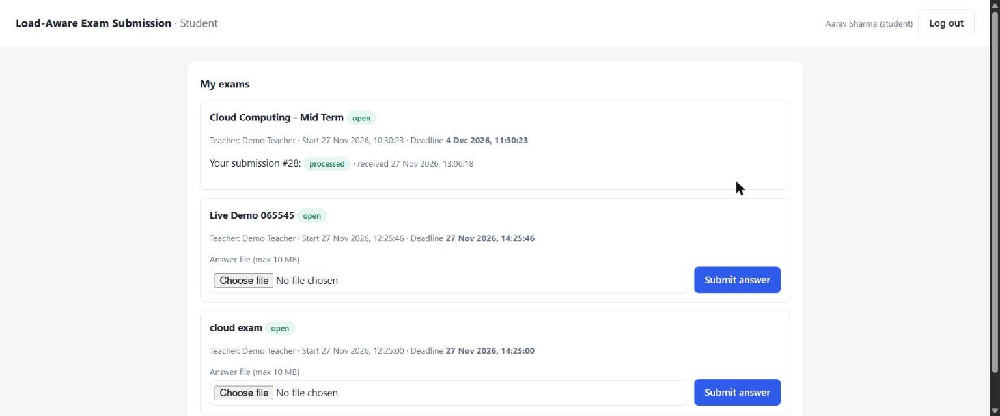
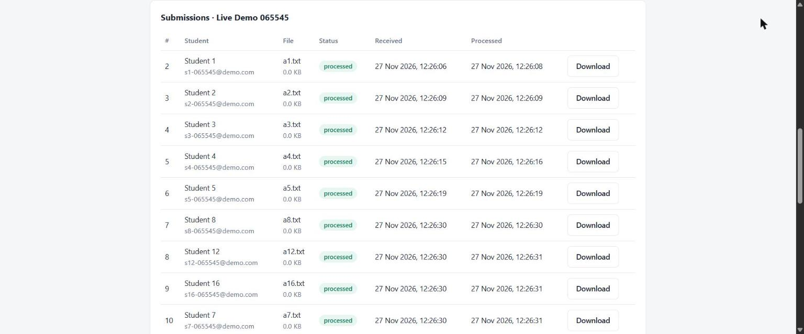
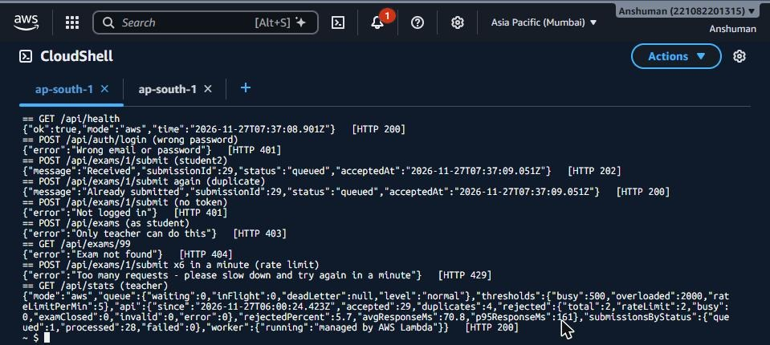

# P14 – Load-Aware Examination Submission System

**Cloud Application Development (CSVT 4018P_4) · Scalability & Load Management**
University of Petroleum and Energy Studies (UPES), School of Computer Science · Anshuman Mohapatra, B-3 (CCVT)

In the last minute before an exam deadline, everyone clicks **Submit** at once. A normal web app that writes straight to the database slows down or crashes, and some students lose their submission.

This system follows one rule: **accept quickly, process later.** The API saves the file to Amazon S3, writes a row to PostgreSQL, puts a message on an Amazon SQS queue and immediately replies **202 Received**. An AWS Lambda worker processes the queue in the background. During a rush the queue simply gets longer. **Once a student sees *Received*, that submission is never lost.**



## Highlights

- **Queueing (SQS):** absorbs submission spikes so the database never sees the full rush
- **Worker scaling (Lambda):** runs up to 10 copies at once as the queue grows
- **Rate limiting:** at most 5 submit requests per minute per student → `429`
- **Overload protection:** more than 2,000 waiting → `503 System busy, retry in 15 s`
- **No lost submissions:** "Received" only after the DB row is saved *and* SQS confirms the message; failed messages are retried and, after 5 tries, kept in a dead-letter queue with a CloudWatch alarm
- **No duplicates:** `UNIQUE (student_id, exam_id)`; a retry returns the existing submission
- **Fair deadlines:** on-time is judged by when the API *accepted* the submission, not when it was processed
- **Security:** bcrypt password hashes, 1-hour JWTs, role checks, private S3 bucket with 5-minute download links, database not reachable from the internet

## Cloud components (AWS ap-south-1, Mumbai)

| Component | AWS service | What it does |
|---|---|---|
| API server | **EC2** t3.micro (Node.js + Express, kept alive by PM2) | Login, exams, submissions, stats, web pages |
| Queue | **SQS** standard queue + dead-letter queue | Holds every accepted submission until it's processed |
| Worker | **Lambda** (Node.js 20) with SQS trigger | Checks the file in S3 and marks the submission processed |
| Database | **RDS** PostgreSQL (db.t3.micro) | Users, exams, submissions |
| File storage | **S3** (private bucket) | Uploaded answer files |
| Monitoring | **CloudWatch** | Worker logs, queue metrics, alarm on the dead-letter queue |
| Networking | **VPC** security groups + S3 gateway endpoint | Only port 3000 open to the internet; Lambda reaches S3 without a NAT gateway |
| Access | **IAM** roles | Least-privilege roles for EC2 and Lambda |

## Screenshots

| Student submits (queued → processed by Lambda) | Teacher view with live stats |
|---|---|
|  |  |
|  |  |

API tests against the live server (202, 200 duplicate, 401, 403, 404, 429):



All 20 screenshots (frontend, backend and every AWS service) are in [`docs/screenshots`](docs/screenshots).

## REST API

All routes start with `/api`. Protected routes need `Authorization: Bearer <token>`.

| # | Method | Endpoint | Who | What it does |
|---|---|---|---|---|
| 1 | POST | `/auth/register` | Anyone | Create an account `{name, email, password, role}` |
| 2 | POST | `/auth/login` | Anyone | Log in → `{token, user}` (JWT valid 1 hour) |
| 3 | POST | `/exams` | Teacher | Create exam `{title, startTime, deadline, maxFileMb}` |
| 4 | GET | `/exams/:id` | Logged in | Exam details and deadline |
| 5 | POST | `/exams/:id/submit` | Student | Upload answer (multipart field `file`) → **202 Received** |
| 6 | GET | `/submissions/:id` | Student (own) / Teacher | Submission status |
| 7 | GET | `/exams/:id/submissions` | Teacher (own exams) | All submissions for an exam |
| 8 | GET | `/stats` | Teacher | Queue size, accepted/rejected counts, response times |
| + | GET | `/exams` | Logged in | List exams (used by the web pages) |
| + | GET | `/submissions/:id/download` | Teacher | Download link that expires after 5 minutes |
| + | GET | `/health` | Anyone | Health check |

```json
{ "message": "Received", "submissionId": 1042, "status": "queued", "acceptedAt": "2026-11-20T10:59:58.000Z" }
```

Errors: `400` bad input or file too large · `401` not logged in · `403` wrong role · `404` not found · `422` exam not open · `429` rate limit · `503` system busy (with `Retry-After`).

## Load levels (SRS 4.3)

| Level | Messages waiting | What happens |
|---|---|---|
| Normal | under 500 | Everything accepted and processed within seconds |
| Busy | 500 – 2,000 | Still accepted; Lambda scales up; status may take a minute |
| Overloaded | over 2,000 | New submissions get `503` + `Retry-After: 15`; accepted ones keep processing |

Thresholds live in `.env` (`RATE_LIMIT_PER_MIN`, `BUSY_THRESHOLD`, `OVERLOAD_THRESHOLD`) and can be changed live with `pm2 restart p14-api`.

## Run it locally

**Windows, one click:** install Node.js (LTS), then double-click **`START-DEMO.bat`**. It installs dependencies, starts a built-in PostgreSQL, creates the tables and demo accounts, and opens http://localhost:3000.

**Any OS, with your own PostgreSQL:**

```bash
npm install
cp .env.example .env          # set JWT_SECRET; DATABASE_URL points to your PostgreSQL
npm run migrate               # create tables
npm run seed                  # demo accounts + an open exam
npm start                     # http://localhost:3000
```

Or `npm run demo` to use the built-in PostgreSQL. Locally, S3 is replaced by a `local-storage/` folder and SQS + Lambda by an in-process queue and worker with the same retry and dead-letter behaviour. The worker code (`worker/processSubmission.js`) is identical in both modes.

Demo accounts (password `demo123`): `teacher@demo.com`, `student1@demo.com`, `student2@demo.com`, `student3@demo.com`.

## Deploy to AWS

From **AWS CloudShell** in `ap-south-1`, inside the project folder:

```bash
bash deploy/deploy.sh      # creates everything (about 15 minutes, mostly RDS) and prints the URL
bash deploy/auto-demo.sh   # optional: self-running demo - normal load, a rush of 12, worker crash and recovery
bash deploy/teardown.sh    # deletes everything so nothing keeps costing money
```

`deploy.sh` is safe to re-run (finished steps are remembered in `~/p14-state.env`). Every resource is tagged `Project=P14`; `teardown.sh` checks that nothing with that tag is left.

## Failure test (SRS 8.1)

Stop the worker mid-test by disabling its SQS trigger, keep submitting, then turn it back on:

```bash
source ~/p14-state.env
aws lambda update-event-source-mapping --uuid $ESM_UUID --no-enabled   # worker "crashes"
# ...students still get 202 Received; the queue grows...
aws lambda update-event-source-mapping --uuid $ESM_UUID --enabled      # worker comes back, queue drains
```

Disabling the trigger (rather than setting Lambda concurrency to 0) is deliberate: throttling a Lambda that reads from SQS counts as failed tries and could push good messages into the dead-letter queue. For the same reason the queue allows 5 tries (AWS's recommendation) and the trigger caps the worker with *maximum concurrency* instead of reserved concurrency.

## Project structure

```
src/
  server.js              start-up (restores the local queue after a restart)
  app.js                 Express app and routes
  config.js              all settings and thresholds
  db.js, logger.js, stats.js
  adapters/storage.js    local disk  | Amazon S3
  adapters/queue.js      local queue | Amazon SQS
  middleware/auth.js     JWT + role checks
  routes/                auth, exams (incl. submit), submissions, stats
worker/
  processSubmission.js   shared worker logic
  handler.js             AWS Lambda entry point (partial batch failures)
  localWorker.js         local stand-in for Lambda
db/schema.sql            tables: users, exams, submissions
scripts/                 migrate.js, seed.js, demo.mjs (built-in PostgreSQL)
public/                  login, student and teacher pages (plain HTML + JS)
deploy/                  deploy.sh, auto-demo.sh, teardown.sh (AWS CloudShell)
docs/                    architecture diagram and screenshots
ecosystem.config.js      PM2 config for EC2
START-DEMO.bat           one-click local run on Windows
```

## Tech stack

Node.js · Express · PostgreSQL (`pg`) · AWS SDK for JavaScript v3 · JWT · bcrypt · express-rate-limit · multer · PM2 · plain HTML/CSS/JS
